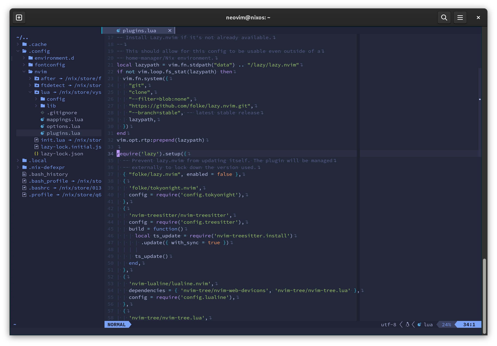

# ✏️ neovim-config

My personal [Neovim][1] configuration as a [home-manager][2] module.



## Overview

- Reproducible environment thanks to [Nix][5]
- Can be used standalone or imported in a home-manager configuration.
- Available as a VM for trying out the configuration and testing.
- Focused on Rust, Typescript, and Nix development.

## Usage

### Nix Flake

- Review the documentation on using [home-manager with Nix Flakes][7].
- Add a `neovim-config` input to your Flake:

  ```nix
  {
    inputs = {
      nixpkgs.url = "nixpkgs/nixos-22.11";
      # ...
      neovim-config = {
        url = "git+https://gitlab.chromabits.com/etcinit/neovim-config.git";
        inputs.nixpkgs.follows = "nixpkgs";
      };
    };
    # ...
  }
  ```
- Import the module in one of your `home-manager` modules:

  ```nix
  {inputs, ...}:
  {
    # ...
    imports = [
      inputs.neovim-config.nixosModules.home-manager.neovim-config↴
    ];
  }
  ```
- Use `home-manager switch` to apply the new configuration.

## Reproducible Environment

When using this configuration as a `home-manager` module, it is possible to build a reproducible environment. Thanks to Nix's reproducible builds, this module will always pull the same versions of all packages/plugins, unless the flake lock is updated.

A previous version of this module made use of Lazy.nvim which offered faster
startup times and a path for using this configuration without Nix. However, it
also resulted in frequent broken setups when attempting to update packages. In
an effort to simplify my setup, I've opted for a full Nix-based solution,
specially now that most of my systems use Nix. This results in slightly slower
startup times (a few 100 ms), but most plugins are now using definitions from
nixpkgs. Version upgrades will follow the NixOS release cycle.

## Development

For a development environment, you can use `nix develop` to open a shell with tools used to work on this module (Lua LSP, `nixos-rebuild`, etc).

The configuration can be tested on an isolated VM or by referencing it locally from another Nix flake.

[Direnv][4] is also pre-configured. Use `direnv allow` to automatically enter the devshell when `cd`-ing to the repository.

### Development VM

Testing the configuration in a VM is the recommended approach since it doesn't alter your current system. The approach uses `nixos-rebuild build-vm` to create and launch a QEMU VM with NixOS and a user pre-configured with home-manager:

- Clone this repository locally.
- Enter the development shell (`nix develop` or use Direnv).
- Build the VM image and script: `nixos-rebuild build-vm --flake .\#vm`.
- Launch the VM: `result/bin/run-nixos-vm`.

**Tips for using the VM:**

- The initial build of the VM image will take a few minutes as Nix downloads cache entries. Subsequent boots take less than 20 seconds on an 11th Gen i7 processor.
- The VM is preconfigured with `neovim` as a user and `example` as a password. This is an insecure setup only provided for convenience. While the VM will run in QEMU usermode, running untrusted software in the VM is not recommended.
- `Ctrl + A C q <ENTER>` can be used to kill the QEMU monitor.
- After the first boot, a `nixos.qcow2` disk image will be created in the repository. This will persist the state of the VM. To start with a fresh environment, `rm nixos.qcow2`.
- Serial console windows won't automatically resize. The VM includes a convenience script, `resize-tty` for updating the window size.

### Nix Flake

- Clone this repository locally.
- From another Nix flake, add an input referencing the repository using a path ([Nix manual on Flake URL-like syntax][3])

[1]: https://neovim.io
[2]: https://github.com/nix-community/home-manager
[3]: https://nixos.org/manual/nix/unstable/command-ref/new-cli/nix3-flake.html#url-like-syntax
[4]: https://github.com/direnv/direnv
[5]: https://nixos.org
[7]: https://nix-community.github.io/home-manager/index.html#ch-nix-flakes
